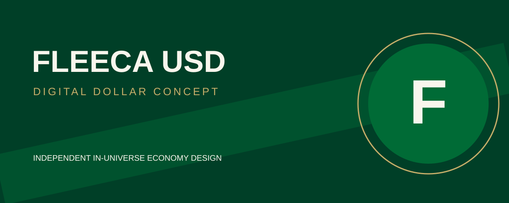
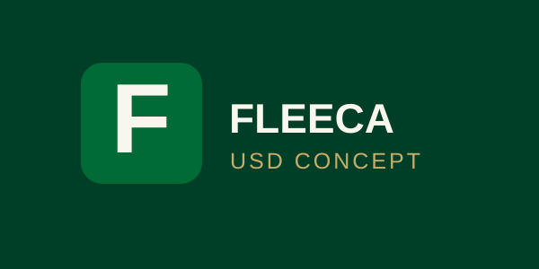
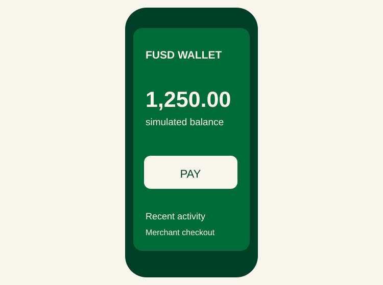
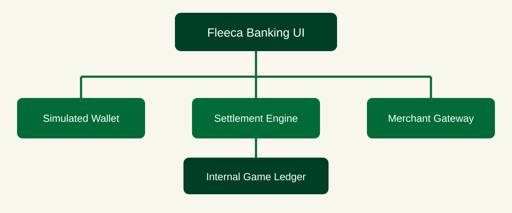

<p align="center"></p>

<h1 align="center">FLEECA USD · FUSD</h1>
<p align="center"><strong>Digital Dollar Infrastructure for Leonida</strong><br>In-universe banking and stablecoin gameplay system · Technical design proposal</p>

> **INDEPENDENT FAN CONCEPT / NOT AN OFFICIAL ROCKSTAR PRODUCT.** This repository is not affiliated with or endorsed by Rockstar Games, Take-Two Interactive, or any in-game brand owner. FUSD in this specification is a **fictional game asset** and not a redeemable or dollar-backed stablecoin. Any independently created real-world token must be identified separately.

---

## 01 / Executive Overview

Fleeca USD (FUSD) is a proposed digital settlement layer for a simulated financial economy set in Leonida. It brings together player accounts, mobile payments, merchant services and market events in a single server-authoritative ledger. The concept is intentionally grounded in Grand Theft Auto's satirical approach to everyday financial systems, without claiming to represent a planned or announced game feature.

**Design goals:** immediate in-game settlement, clear monetary rules, interesting emergent gameplay and robust protection against duplicated balances. **Out of scope:** real-world banking, custody of real funds, real fiat redemption, real stablecoin issuance and any claim of an official GTA VI integration.

<p align="center"></p>

## 02 / Core Asset — FUSD

| Field            | In-universe specification                         |
| ---------------- | ------------------------------------------------- |
| Display name     | Fleeca USD                                        |
| Ticker           | `FUSD`                                            |
| Asset class      | Simulated, dollar-denominated game currency       |
| Reference unit   | `1 FUSD = 1 simulated in-game USD`                |
| Issuer           | Fictional Fleeca banking network (narrative only) |
| Settlement       | Centralized, server-authoritative simulation      |
| On-chain network | None required for the fictional gameplay system   |
| Status           | Independent, unimplemented concept                |

<p align="center"></p>

### Real-world token reference (optional, independent)

The project may be discussed alongside a separately issued community token. Such a token **is not FUSD within the game, is not issued by Fleeca or Rockstar, and has no implied $1 peg**.

```text
Community token chain: Solana (only if independently issued)
Community token mint / CA: FUSDe5mFR43v9tsXzbM4KUF9eEwCq3KfBHCDzPVRXN4w
Status: Unaffiliated community token; not an official stablecoin
```

**Do not replace the placeholder with a wallet address, private key or fabricated token mint.** If no independently issued token exists, leave this section unconfigured or remove it.

## 03 / Banking Network

The concept uses a wallet-facing banking app and a backend ledger. Account balances are projections of immutable transactions. Every operation includes a unique idempotency key to prevent accidental repeated credits.

- Personal and business-style account views
- Transfers between simulated players and NPC merchants
- Explicit fees before confirmation
- Searchable statement and transaction receipt history
- Optional mission-specific account holds, reversals and investigations

## 04 / Digital Wallet

<p align="center"></p>

A fictional mobile wallet provides balance, recent activity and a deliberate transfer flow: select recipient → enter amount → preview fee → confirm → ledger receipt. The experience should not require the player to connect a real blockchain wallet.

## 05 / Merchant Settlement

Payment requests have an expiry, recipient, purpose and expected amount. A server-side check validates account funds and merchant eligibility before authorizing a transfer. Receipts tie a purchase to a transaction record, allowing future gameplay events such as refunds, chargebacks or fraud disputes.

## 06 / Monetary Model

A target in-game denomination of 1 FUSD per in-game dollar is a **game-design invariant**, not a promise of a financial peg. Supply creation occurs only through defined gameplay triggers and is backed by corresponding simulated balance-sheet entries.

Let `S_t` represent total outstanding FUSD at time `t`, `M_t` newly issued FUSD and `R_t` redeemed/burned FUSD:

`S_(t+1) = S_t + M_t - R_t`

At each step the simulated ledger must maintain asset/liability equality and block undercollateralized balance creation. No design here establishes real-world reserve backing.

## 07 / Exchange & Market Events

FUSD acts as the steady unit of account for a **fictional** marketplace. A satirical market-event subsystem could model rumors, banking outages, predatory fees, liquidity crunches and speculative virtual assets. Such mechanics are gameplay fiction and not recommendations for real-world financial conduct.

<p align="center"></p>

## 08 / Architecture

<p align="center"></p>

| Component         | Responsibilities                                   |
| ----------------- | -------------------------------------------------- |
| Banking UI        | Balances, send flow, receipts                      |
| Wallet service    | Account permissions and transfer intents           |
| Settlement engine | Atomic balance movement, fees, idempotency         |
| Merchant gateway  | Purchase authorization and receipts                |
| Ledger            | Append-only transaction journal and reconciliation |
| Risk service      | Limits, anomaly detection, recovery paths          |

Example transaction lifecycle:

1. Validate account and recipient.
2. Reserve the amount and calculate disclosed fees.
3. Write balanced debit/credit entries in a single atomic commit.
4. Deliver an idempotent receipt.
5. Reconcile the ledger against account projections.

## 09 / Security & Integrity

- All material balance mutations are authoritative on the game server.
- No client-supplied balance or fee amount is trusted.
- Replay protection and idempotency keys are mandatory.
- Rate limits and transaction caps are configurable.
- Every operation produces auditable journal entries.
- Recovery procedures use compensating entries instead of deleting history.

## 10 / Visual System

<p align="center"></p>

**Visual direction:** emerald banking green, ivory/off-white backgrounds, restrained brass highlights, high-contrast typography and low-noise vector forms. This fan-made concept uses an original supplied avatar and its own derived presentation assets. It must not be mistaken for an official bank interface or product announcement.

## 11 / Example Configuration

See [`config/brand.json`](config/brand.json) and [`config/economy.example.json`](config/economy.example.json) for illustrative settings. No live services, tokens, on-chain contracts or banking infrastructure are deployed by this package.

## 12 / Status & Milestones

| Milestone                      | State                       |
| ------------------------------ | --------------------------- |
| Design specification           | Draft                       |
| Identity and visual kit        | Concept assets included     |
| UI prototype                   | Not implemented             |
| Game-server ledger integration | Not implemented             |
| QA and simulation              | Not implemented             |
| Official game integration      | Not requested or authorized |

## 13 / Attribution & Legal

This independent concept refers to the fictional Fleeca banking brand solely to describe a fan-made game design idea. Grand Theft Auto, Fleeca and associated names remain the property of their respective owners. The supplied artwork and generated diagrams do not grant rights to those names. This project is not an investment product, payment service or stablecoin offering.

For original text and graphics in this package, see [`LICENSE`](LICENSE). The user-supplied image is included as provided; rights to that image are not assigned by the license.
