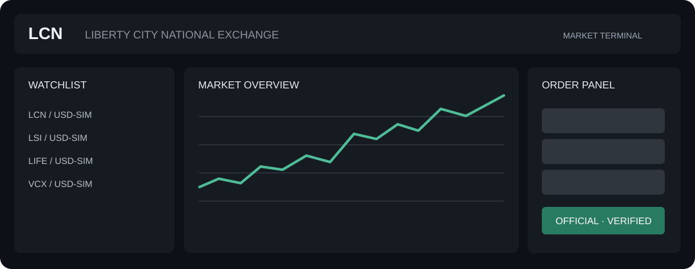
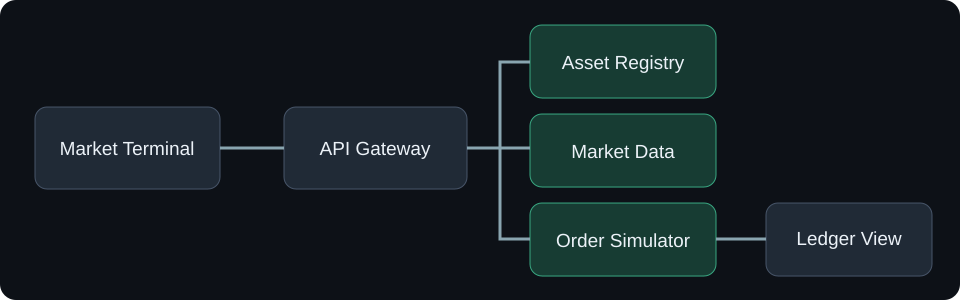

<p align="center"></p>
<h1 align="center">Liberty City National Exchange</h1>
<p align="center"><strong>Market Terminal · Asset Registry · Settlement Infrastructure</strong></p>
<p align="center"><code>LCN</code> · <code>market-terminal</code> · <code>asset-registry</code> · <code>v0.1.0</code></p>



## Overview

The Liberty City National Exchange (LCN) market terminal defines a modular interface for securities-style instruments, digital-asset identifiers, quote distribution, portfolio accounting, and simulated clearing. The specification uses product-level language and conventional engineering boundaries to make the proposed interface testable, auditable, and easy to extend.

### System components

| Component          | Responsibility                                | Interface       |
| :----------------- | :-------------------------------------------- | :-------------- |
| Market Gateway     | Receives read-only quotes and reference data  | REST/JSON       |
| Asset Registry     | Symbol mapping, identifiers, listing status   | Registry schema |
| Matching Simulator | Order lifecycle and deterministic fills       | Event stream    |
| Ledger View        | Double-entry posting and reconciliation       | Ledger events   |
| Risk Service       | Price collars, stale quotes, session halts    | Rule set        |
| Web Terminal       | Positions, watchlists, order ticket and depth | UI components   |

## Official verified asset

The official verified asset record is used to demonstrate how a market terminal displays a blockchain identifier.

| Field                   | Value                                         |
| :---------------------- | :-------------------------------------------- |
| Display name            | Liberty City National Exchange                |
| Symbol                  | `LCN`                                         |
| Network label           | `solana-mainnet`                              |
| Asset standard          | `SPL`                                         |
| Example mint identifier | `LCNxYmDuyKuJvDBW9iWPTTSjgirzXjwesm5eyy1tb7t` |
| Verification status     | `verified`                                    |
| Backing / issuer        | `established`                                 |

**Mint identifier**

```text
LCNxYmDuyKuJvDBW9iWPTTSjgirzXjwesm5eyy1tb7t
```

## Market model

- **Session states:** pre-open, continuous session, volatility pause, close.
- **Order types:** limit and market orders in a deterministic simulator.
- **Price data:** quote freshness flags, last-trade reference, candles and volume.
- **Balances:** simulated available, reserved, and settled position balances.
- **Risk:** maximum price deviation, position controls, order idempotency.
- **Audit:** event IDs, monotonic sequence numbers, ledger reconciliation.

## Architecture



See [`docs/SYSTEM_ARCHITECTURE.md`](docs/SYSTEM_ARCHITECTURE.md) for the domain contracts and failure boundaries.

## Configuration

- [`config/asset.example.json`](config/asset.example.json) — reference asset metadata
- [`config/market.example.json`](config/market.example.json) — session and risk parameters
- [`docs/ASSET_REGISTRY.md`](docs/ASSET_REGISTRY.md) — registry lifecycle
- [`docs/SETTLEMENT.md`](docs/SETTLEMENT.md) — illustrative ledger events
- [`docs/SECURITY.md`](docs/SECURITY.md) — controls and integrity checks
- [`docs/RELEASE_NOTES.md`](docs/RELEASE_NOTES.md) — preview scope
