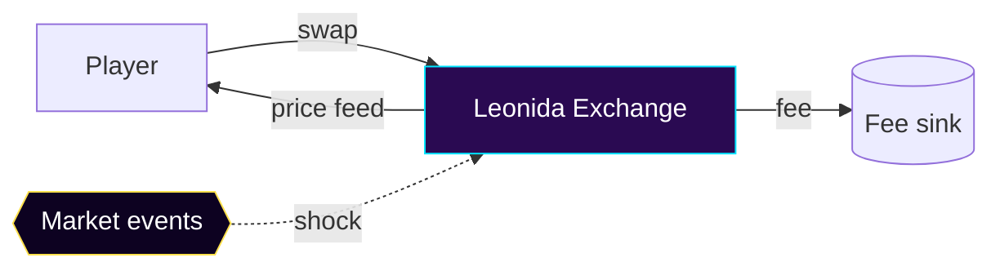
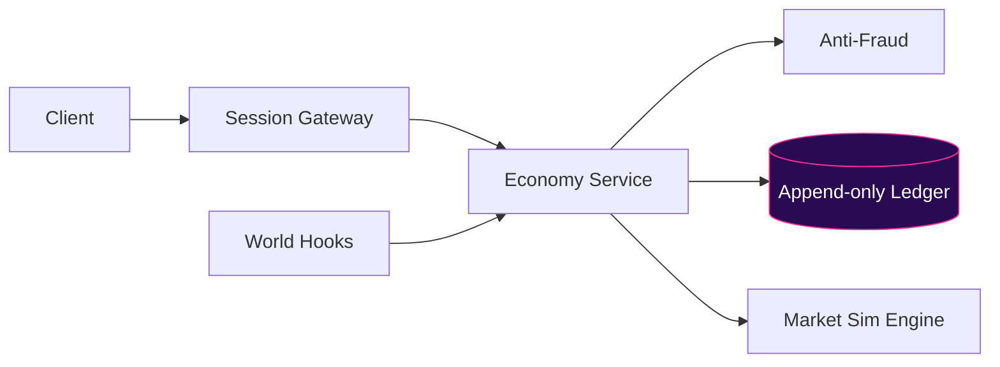
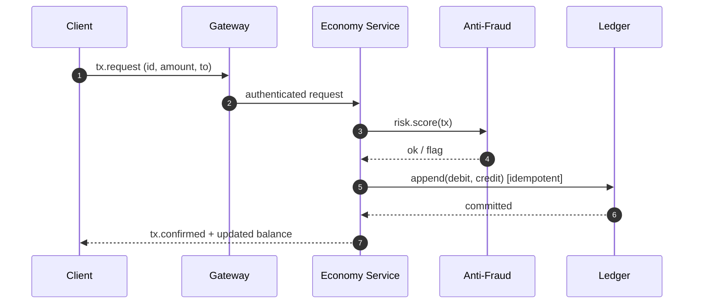

# $FLAMINGO — In-Universe Crypto Economy for GTA VI / GTA Online
### Official Design Proposal · Rockstar Games · Under Discussion & Testing

<div align="center">



<br/>


</div>

> **Flame Ingo (`$FLAMINGO`) is the digital currency of Leonida.** A volatile, satirical, fully simulated crypto ecosystem running inside GTA VI — designed as the third pillar of the state's economy, alongside cash and banks. This document covers the proposed mechanics: **on-chain-style trading, player-created memecoins, gambling, laundering, mining, and market manipulation.**
>
> **Internal testing wallet (dev environment only):**
> `GTA6xquCcBXRYVwxktgkebprkDCKgXhiV7Fc7fe1iyaT`
>
> This is the seed wallet for the current economy simulation tests. It holds simulated `FLAMINGO` balances used to validate swap flows, faucet caps and market-tick determinism. No real-world value, no real chain.

---

## Table of Contents

1. [Overview](#1-overview)
2. [Core Token: $FLAMINGO](#2-core-token-flamingo)
3. [The Leonida Exchange (LDX)](#3-the-leonida-exchange-ldx)
4. [Player-Created Memecoins](#4-player-created-memecoins)
5. [Online Gambling in Leonida](#5-online-gambling-in-leonida)
6. [Wallet, Kiosks & the Parallel Economy](#6-wallet-kiosks--the-parallel-economy)
7. [Mining, Laundering & Market Crime](#7-mining-laundering--market-crime)
8. [Price Simulation Model](#8-price-simulation-model)
9. [Architecture & Anti-Cheat](#9-architecture--anti-cheat)
10. [Roadmap](#10-roadmap)
11. [License](#11-license)

---

## 1. Overview

Leonida runs on three economies:

| Economy | Nature | Role |
|---|---|---|
| **Cash** | Physical, traceable | Legit earnings, daily life |
| **Banked money** | Digital, frozen when busted | Legal façade, property |
| **$FLAMINGO** | Digital, volatile, quasi-anonymous | The gray market of Vice City |

Flame Ingo is **fast, anonymous(ish), and volatile** — perfect for a state where influencers, hustlers and laundering crews coexist. Every mechanic below is **simulated server-side**: no real blockchain, no real-world value, zero conversion to fiat. The satire is the point.

**Design pillars**

- A *playable* financial system, not a spreadsheet.
- Emergent narrative: pump & dumps, rug pulls, crew wars over kiosks, influencers moving markets.
- Full satirical alignment with the series' take on crypto culture.
- Zero real-money hooks — eliminates RMT, fraud and regulatory exposure at the root.

---

## 2. Core Token: $FLAMINGO

| Property | Value |
|---|---|
| Ticker | `FLAMINGO` |
| Supply | Regulated via faucet caps and progressive sinks |
| Volatility | High, event-driven, mean-reverting |
| Anonymity | Quasi-anonymous — attracts NPC police heat above thresholds |
| Utility | Black market purchases, swap, gambling stakes, laundering output |

- **Rewards:** heists and missions can pay out partially in $FLAMINGO — untraceable, but volatile. Your choice: dirty money now, clean risk later.
- **Holding:** wallets earn/lose nothing passively — but inactive funds in exchange custody accrue "maintenance fees" (a narrative sink).
- **Heat:** large unexplained $FLAMINGO balances raise a **Suspicion Meter**, drawing police investigations, freezes, or asset seizure events.

---

## 3. The Leonida Exchange (LDX)

The central marketplace, accessible from the in-game phone and physical kiosks around Vice City.



**Features**

- **Swap:** $FLAMINGO ⇄ cash, and $FLAMINGO ⇄ listed memecoins — with a commission that scales with volume (anti-whale sink).
- **Live ticker:** 24h charts, order-book flavor, radio/TV commentary from satirical finance channels.
- **Rate manipulation:** crews that control kiosks can worsen local exchange rates for hours — territory gameplay meets market gameplay.
- **Listing events:** new tokens (NPC or player-driven) hit the exchange with ICO-style hype cycles and the inevitable crash.

---

## 4. Player-Created Memecoins

**One of the central hypotheses of this proposal.** Players (and NPCs) can launch their own tokens on the in-universe chain — alongside the core $FLAMINGO token.

| Phase | Mechanic |
|---|---|
| **Launch** | Name, ticker, logo from a preset kit; seed liquidity from the player's own $FLAMINGO |
| **Hype** | In-world influencers can be paid to shill a token — pumping the price for a limited window |
| **Pump** | Other players see the token trending on LDX and the radio; late buyers fuel the spike |
| **Dump** | Early holders (or the creator) can exit — price collapses, bag-holders narratively ruined |
| **Rug pull** | The creator can drain liquidity entirely. This is a *feature*: a designated betrayal mechanic, with in-world consequences (bounties, crew retaliation) |
| **Delisting** | Dead tokens are swept weekly; holders can claim a tiny "graveyard tax" write-off |

**Anti-abuse:** token creation is rate-limited, launch costs scale with recent creations, and NPC regulators can "freeze" tokens flagged as outright scams — creating legitimate gray-zone gameplay around what counts as a scam (very Leonida).

**NPC memecoin roster:** a rotating cast of satirical NPC tokens (e.g., *ChainsawCoin*, *KalagaToken*) driven by world events — Mount Kalaga wildfire? Timber-adjacent tokens spike. The core $FLAMINGO price is tied to flamingo-migration events in the Leonida Keys, because obviously it is. This ties world simulation to market simulation.

---

## 5. Online Gambling in Leonida

**The second central hypothesis of this proposal:** fully integrated, $FLAMINGO-denominated online gambling.

- **Casino games** — poker, blackjack, slots, sports betting on in-world events (street races, underground fights) — staked in $FLAMINGO.
- **No real-money conversion.** Everything is simulated currency. The casino never cashes out to dollars.
- **Market-linked betting:** odds react to live market events — bet on whether $FLAMINGO crashes before Friday, or on which memecoin survives the week.
- **High-roller rooms** unlock with status progression, featuring whale NPCs with exploitable behavioral patterns.

**Player protection mechanics** (rating-friendly, non-predatory):

| Mechanic | Detail |
|---|---|
| Daily stake caps | Configurable soft and hard limits |
| Session cooldowns | Optional self-imposed lockouts |
| Transparent odds | RTP and probabilities visible in UI |
| No pay-to-win link | Gambling outcomes never gate progression or competitive items |

Satirical framing: the casino is run by a shameless in-world operator who advertises "guaranteed systems" on late-night radio — the game mocks the gambling industry while being a responsible member of it.

---

## 6. Wallet, Kiosks & the Parallel Economy

### The Wallet App (in-game phone)

- Balance, 24h chart, transaction history.
- Actions: **Send**, **Swap**, **Stake** (on select NPC tokens), **Stash** (cold-storage in a safehouse).
- Separate wallets for Lucia and Jason, plus a **joint account** — the couple mechanic extended to money. Trust is gameplay.
- Toast notifications styled like the HUD; satirical push alerts from shill influencers.

### Kiosks & sinks

| System | Mechanic | Type |
|---|---|---|
| **Exchange kiosks** | Cash ⇄ $FLAMINGO swaps with fees, volume limits, territory-controlled rates | Sink |
| **Black market** | Weapons, vehicles, forged documents purchasable in $FLAMINGO | Sink |
| **Crew tributes** | Weekly protection payments to whichever crew controls your district's kiosks | Sink |
| **Custody decay** | Idle exchange balances bleed maintenance fees | Sink |

---

## 7. Mining, Laundering & Market Crime

| System | Mechanic |
|---|---|
| **Mining rigs** | Placeable in safehouses; slow $FLAMINGO yield, high power draw. Overload the grid → brownouts in the neighborhood → NPC reports → police heat |
| **Laundering loop** | Convert dirty cash → $FLAMINGO via layered swaps through multiple kiosks → clean withdrawals. Each hop costs fees but reduces Suspicion |
| **Mixer NPCs** | For a cut, fictional "mixing services" obfuscate transaction history — at the risk of the mixer itself getting raided |
| **Freeze events** | LCPD can freeze suspect wallets: stash and mixer choices become tactical |
| **Market manipulation missions** | Story and emergent missions to *execute* or *expose* pump & dumps, rug pulls and insider trading on LDX |

The radio and in-world TV track it all: a satirical financial-news channel comments on crashes and scams, doubling as a market signal for attentive players.

---

## 8. Price Simulation Model

Server-side, deterministic per session: everyone in the same session sees the same curve. Suggested model: **geometric Brownian motion with mean reversion and event jumps.**

```text
ln S(t+Δt) = ln S(t)
           + (μ − σ²/2)·Δt
           + k·(ln A − ln S(t))·Δt     ← mean reversion to anchor A
           + σ·√Δt·Z                   ← noise, Z ~ N(0,1), seeded
           + J(t)                      ← event jumps (pumps, crashes, raids)
```

```ts
// market tick pseudocode
function tick(state: MarketState, dt: number, rng: SeededRng, events: Shock[]): number {
  const z = rng.normal();
  const jump = events.reduce((acc, e) => acc + e.magnitude, 0);
  const drift = (state.mu - 0.5 * state.sigma ** 2) * dt;
  const revert = state.k * (Math.log(state.anchor) - Math.log(state.price)) * dt;
  const noise = state.sigma * Math.sqrt(dt) * z;
  return state.price * Math.exp(drift + revert + noise + jump);
}
```

**Inflation control**

| Lever | Example |
|---|---|
| Faucet caps | Daily per-player $FLAMINGO generation limits (mining, missions) |
| Progressive sinks | Volume-scaled swap fees, crew tributes, custody decay |
| Anchoring | Mean reversion prevents infinite spirals |
| Regulatory sinks | Police freezes and scam delistings remove supply narratively |

All starting parameters live in [`config/economy.example.json`](config/economy.example.json). Current simulation runs are executed against the internal testing wallet (`GTA6xquCcBXRYVwxktgkebprkDCKgXhiV7Fc7fe1iyaT`) to validate faucet caps and tick determinism. Every number **must be balanced through playtesting**.

---

## 9. Architecture & Anti-Cheat



- **Server-authoritative:** the client only *displays*; the server decides every balance.
- **Double-entry, append-only ledger** with idempotency keys on every transaction (anti-replay, anti-double-spend). Periodic reconciliation: sum of all accounts = 0.
- **Signed requests + rate limiting** at the gateway.
- **Anti-fraud heuristics:** anomalous accumulation velocity, account-loop patterns, world-event/payout mismatches.
- **Full audit trail** enabling targeted rollbacks.
- **No real-world value** anywhere in the loop — RMT and value theft are structurally impossible. The testing wallet and all dev-environment balances are simulated only.



---

## 10. Roadmap

- [x] Concept, vision, art direction, animated SVG assets
- [x] Initial config (`brand.json`, `economy.example.json`)
- [x] **Currency name locked: Flame Ingo ($FLAMINGO)**
- [ ] Monte Carlo balancing simulations (`sim/market_sim.py`)
- [ ] Ledger JSON Schema + reconciliation tests
- [ ] Storyboards for 3 pilot missions (heist payout, laundering chain, rug pull)
- [ ] Memecoin creation-kit prototype (naming, launch flow, hype timers)
- [ ] Casino vertical slice: poker table + $FLAMINGO staking + stake caps
- [ ] Full UI design system (components, states, motion, audio)
- [ ] Legal/rating review (gambling representation, PEGI/ESRB)
- [ ] Closed playtests → economy tuning pass

---

## 11. License

Documentation and original graphic assets: **CC BY 4.0** (see [`LICENSE`](LICENSE)).

<div align="center">

<sub>made with neon, palms and a concerning amount of sunset gradients · <b>$FLAMINGO</b> — the flamingo earns its keep</sub>

</div>