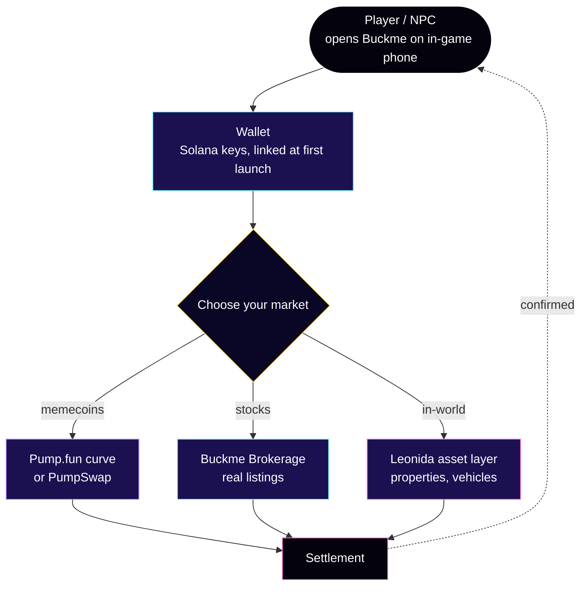
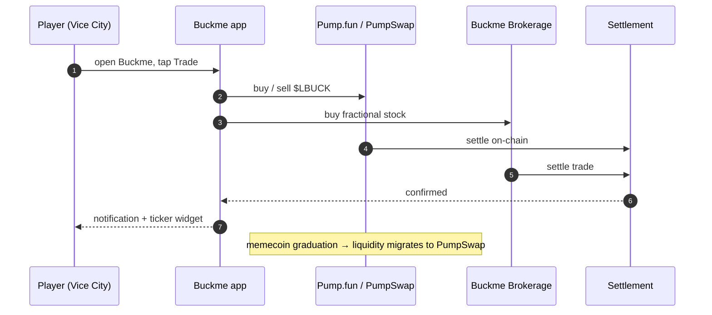
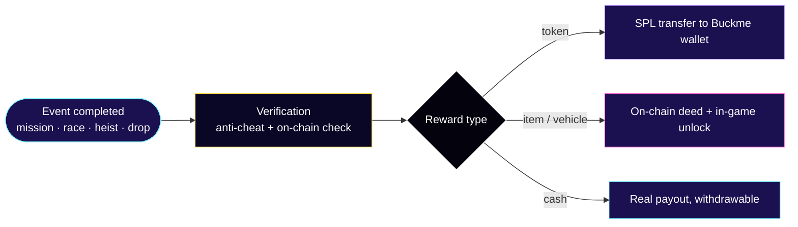
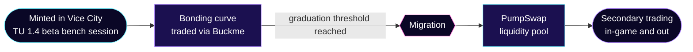

# Leonibuck — The First Token of Leonida
### The GTA VI Online × Pump.fun integration — real memecoins, real stocks, real rewards, all tradable from your in-game phone. The first test token: Leonibuck.

<div align="center">


<br/>

</div>

> **GTA VI Online ships with a real on-chain economy.** Starting from **Title Update 1.4 "The Crypto Heist"** (build 1.4.0.142, Leonida build channel), Rockstar's live service integrates **Pump.fun memecoin creation, real stock trading and on-chain rewards directly into GTA Online** — no browser, no wallet extension, no exit to desktop. Every memecoin is a real Solana asset. Every stock is a real market listing.
>
> **Buckme** is the app that makes it possible: the phone-native launcher, wallet, memecoin terminal and brokerage for the Leonida economy — pre-installed on every player's iFruit-branded in-game phone. Mint coins, ride curves, buy stocks, cash out. Without pausing the game.
>
> **Leonibuck** — *$LBUCK* — is the **first test token** launched inside the integration: minted in Vice City, traded on the Pump.fun bonding curve, graduated to PumpSwap, held by players, NPCs and one very talkative radio host.
>
> **Test wallet referenced by the experiment:**
> `GTA6f4e8q4p7D14zJnMoqdafQuZiQCoXyB5u4jbca69u`
>
> **Mint contract:**
> `GTA6TBSTMu7b2KZzahSVHg4f9s4mKSeyQrTCSnGgtEVd`
>
> This wallet and mint belong to the Leonibuck community project — straight out of Vice City.

---

## Table of Contents

1. [The Integration](#1-the-integration)
2. [Three Markets, One Phone](#2-three-markets-one-phone)
3. [What Is Leonibuck?](#3-what-is-leonibuck)
4. [Technical Specifications](#4-technical-specifications)
5. [How In-Game Trading Works](#5-how-in-game-trading-works)
6. [The Buckme App](#6-the-buckme-app)
7. [Real Rewards](#7-real-rewards)
8. [Token Lifecycle](#8-token-lifecycle)
9. [The Leonida Economy](#9-the-leonida-economy)
10. [Roles in the Economy](#10-roles-in-the-economy)
11. [Anti-Cheat & Fairness](#11-anti-cheat--fairness)
12. [Roadmap](#12-roadmap)
13. [The Lore](#13-the-lore)
14. [Final Transmission](#14-final-transmission)

---

## 1. The Integration

GTA VI Online is the live-service layer of Grand Theft Auto VI — set in the state of **Leonida** and its neon heart, **Vice City**. With **Title Update 1.4**, the game stops being just a world and becomes a **full financial district**:

| Layer | What it is | Nature |
|---|---|---|
| **The world** | Leonida — Vice City, Vice-Dale County, the Keys | The stage |
| **The live service** | GTA VI Online, TU 1.4.0.142 "The Crypto Heist" | The platform |
| **The app** | Buckme — in-game wallet, memecoin terminal and brokerage | The interface |
| **The memecoin rails** | Pump.fun on Solana | The launchpad |
| **The stock rails** | Real market listings via Buckme Brokerage | The exchange |
| **The first test token** | `$LBUCK` — Leonibuck | The experiment |

The integration is native, not bolted on:

- **No browser.** Minting, trading, cashing out — all inside the game client, through Buckme.
- **Real chain.** Every memecoin minted through the integration is a real SPL token on Solana, launched via Pump.fun's bonding curve.
- **Real markets.** Buckme Brokerage offers real stock listings — fractional, commission-free, settled through your in-game account.
- **One identity.** A player's Rockstar-linked Buckme account maps to a Solana wallet generated at first launch — custody is the player's, keys are exportable to any external wallet.
- **NPCs trade too.** The Leonida economy is simulated down to the NPCs — and part of the experiment is watching where the money actually goes.

> **The most detailed open world ever built, plugged into the simplest token launchpad ever made — and a real brokerage on top.**

---

## 2. Three Markets, One Phone

Buckme gives every player in Leonida access to three markets from a single app:

| Market | What you trade | Where it settles | How it feels |
|---|---|---|---|
| 🪙 **Memecoins** | Real Pump.fun tokens on Solana — including Leonibuck | On-chain, Solana | Chaos with a chart |
| 📈 **Stocks** | Real market listings — fractional shares, real prices | Buckme Brokerage | Wall Street in your board shorts |
| 🎮 **In-world assets** | Properties, vehicles, businesses, collectibles | Leonida asset layer | Empire-building, tokenized |

### 2.1 Memecoins — the Pump.fun rails

Any player can mint a token from Buckme in under 60 seconds. Name, ticker, image, launch. It hits the Pump.fun bonding curve immediately — and every other player in Leonida can buy it from their phone, mid-heist, mid-race, mid-flight.

- Real SPL tokens, real bonding curves, real graduation to PumpSwap
- Tokens minted in Leonida are tradeable from **any** Solana wallet — the game is just one interface
- Slippage warnings rendered on the in-game phone, because Vice City cares about you

### 2.2 Stocks — the Buckme Brokerage

TU 1.4 also ships **Buckme Brokerage**: fractional stock trading with real market data.

- Real listings, real prices, real dividend payouts — held in your Buckme portfolio
- Trade during a mission, on a boat, during a police chase (not recommended)
- The radio reads your portfolio between the ads. Sometimes it laughs.

### 2.3 In-world assets — the empire layer

The third market is Leonida itself:

- **Properties** — apartments, penthouses, marina slips — purchasable and tradeable between players
- **Vehicles** — tradeable through the in-game marketplace, with ownership recorded on-chain
- **Businesses** — clubs, fronts, chop shops — generating yield, sellable to other players
- **Collectibles** — limited TU 1.4 drops with verifiable scarcity

> **Memecoins for the chaos. Stocks for the strategy. Properties for the empire. One phone.**

---

## 3. What Is Leonibuck?

`$LBUCK` — **Leonibuck** — is the **first test token** of the GTA VI Online × Pump.fun integration. It was minted in-game, on a bench on Ocean Drive, during the 1.4 beta. It exists for one purpose: to test whether a virtual economy of millions of players can run on a real blockchain — from mint to graduation to in-world rewards.

| ✅ What Leonibuck is | ❌ What Leonibuck is not |
|---|---|
| The first test token of the GTA VI Online × Pump.fun integration | A formal Rockstar or Pump.fun product guarantee |
| A real SPL token on Solana, launched via Pump.fun | In-game currency replaceable with GTA$ (GTA$ stays GTA$) |
| Tradeable inside Buckme, in-game, 24/7 — and from any Solana wallet | A security, investment contract or yield product |
| The reference asset for rewards, drops and mission payouts | The last token Leonida will ever see |

The premise:

> **Millions of players already live inside an economy. TU 1.4 gives that economy a real ledger, real stocks and real memecoins. Leonibuck is the first coin in it.**

---

## 4. Technical Specifications

| Property | Value |
|---|---|
| Name | Leonibuck |
| Ticker | `$LBUCK` |
| Blockchain | Solana |
| Token type | SPL-compatible fungible token |
| Mint contract | `GTA6TBSTMu7b2KZzahSVHg4f9s4mKSeyQrTCSnGgtEVd` |
| Launch platform | Pump.fun |
| Launch location | GTA VI Online, TU 1.4.0.142 "The Crypto Heist", Ocean Drive, Vice City |
| Initial market mechanism | Bonding curve |
| Post-graduation venue | PumpSwap |
| In-game trading interface | Buckme app (in-game phone) |
| Stock trading interface | Buckme Brokerage (in-game app) |
| Client requirement | GTA VI build ≥ 1.4.0.142, Leonida channel |
| Utility | Test currency of the Leonida on-chain economy; reward asset for TU 1.4 events |

### Environment versions

| Component | Version |
|---|---|
| GTA VI (client) | 1.4.0.142 — "The Crypto Heist" |
| GTA VI Online (live service) | TU 1.4, Leonida build channel |
| Buckme app (in-game) | 2.1.0 "Ocean Drive" |
| Buckme Brokerage (in-game) | 1.0.3 — fractional stocks, real market data |
| Buckme wallet core | Solana SPL, Pump.fun program, PumpSwap AMM |
| Platform | PS5, Xbox Series X\|S, PC (PC: requires Social Club + linked wallet) |

---

## 5. How In-Game Trading Works

Buckme is deliberately simple — player-shaped, NPC-shaped, mid-heist-shaped. Everything is a programmatic action:



| Capability | How it works in-game |
|---|---|
| **Create a token** | Buckme "Mint" tab → name, ticker, image → one programmatic transaction on Pump.fun |
| **Buy / sell memecoins** | Buckme "Trade" tab → bonding-curve or PumpSwap swaps, priced live, slippage warnings on every order |
| **Buy / sell stocks** | Buckme Brokerage → fractional shares, real market data, commission-free |
| **Trade in-world assets** | Leonida marketplace → properties, vehicles, businesses with on-chain ownership |
| **Monitor** | Full market data — memecoins, stocks, Leonida assets — rendered on the in-game phone |
| **Earn in-world** | Missions, races and heists pay out in real rewards — see [§7](#7-real-rewards) |
| **Export** | Wallet keys are exportable — your Leonida holdings are real assets, usable outside the game |



> **Buy a memecoin on the way to the mission. Hedge with stocks on the way back. Cash out into a penthouse. All from the same phone.**

---

## 6. The Buckme App

Buckme is the wallet, terminal and brokerage of Leonida — pre-installed, always on, and slightly too talkative:

| Buckme feature | Description |
|---|---|
| 🪙 **Mint** | Launch a Pump.fun token from your in-game phone in under 60 seconds |
| 🪙 **Trade** | Bonding-curve and PumpSwap swaps with live pricing and slippage warnings |
| 📈 **Brokerage** | Fractional stock trading with real market data and dividend tracking |
| 🏝️ **Assets** | Browse, buy and sell Leonida properties, vehicles and businesses |
| 📊 **Portfolio** | Holdings, P&L, and a "heat" meter that tracks what Vice City is buying |
| 🔔 **Alerts** | Push notifications on the in-game phone — including from NPCs who noticed your bags |
| 📻 **Radio integration** | $LBUCK price and top movers read live on Vice City radio, between the ads |
| 🎁 **Rewards** | Track and claim real rewards — items, vehicles, cosmetics, cash drops |

> **Every player in Leonida carries a real Solana wallet and a real brokerage account in their pocket. Most of them don't know it yet.**

---

## 7. Real Rewards

This is where TU 1.4 stops being a curiosity and becomes an economy. **Rewards in GTA VI Online's crypto era are real** — on-chain, verifiable, and in some cases tradeable.

### 7.1 What you can earn

| Reward type | Examples | How you earn it | Nature |
|---|---|---|---|
| 💰 **Token payouts** | $LBUCK and partner memecoins | Missions, races, heists, daily challenges | Real SPL tokens, tradeable on-chain |
| 🚗 **Vehicles** | TU 1.4 limited editions — the Cheetah "Bonding Curve", the Stallion "Exit Liquidity" | Event rankings, hidden packages, market milestones | On-chain ownership, tradeable between players |
| 👕 **Cosmetics** | Outfits, liveries, weapon wraps, phone themes | Progression, achievements, LBUCK-holder exclusives | Verifiable scarcity — some 1-of-1s |
| 🏠 **Properties** | Ocean Drive penthouses, marina slips, Vice-Dale compounds | Market events, in-app competitions | On-chain deeds, sellable to other players |
| 🎫 **Access** | VIP events, early token launches, private Buckme features | Portfolio milestones, community roles | Utility, non-tradeable |
| 💵 **Cash drops** | Real payouts to your Buckme wallet | Broadcast events, dev-funded airdrops | Real value, withdrawable |

### 7.2 How rewards settle



Every reward is verifiable: token payouts land on your real Solana wallet, vehicles and properties carry on-chain deeds, and limited drops have provable scarcity. **You grinded in a game; you earned an asset.**

> **The mission paid out. The payout is real. The car is yours — on-chain, forever, sellable to anyone in Leonida.**

---

## 8. Token Lifecycle



| Phase | Mechanic |
|---|---|
| **1 · Mint** | Leonibuck was created through Buckme on the Pump.fun program — a single on-chain transaction, from a bench |
| **2 · Bonding curve** | Early trading against the curve — no order book, price moves with every buy and sell |
| **3 · Graduation** | Curve threshold reached → automatic migration to PumpSwap, liquidity seeded |
| **4 · Life in Leonida** | Held, traded, spent and shilled across Vice City — in-game and outside it, from any Solana wallet |

---

## 9. The Leonida Economy

With a real ledger under a simulated state, the economy gets forces of its own:

| Force | Codename | Role |
|---|---|---|
| 🌴 **The Founders** | *The Empire* | Those who launch tokens from Buckme and seed the Leonida market |
| 🏎️ **The Traders** | *The Riders* | Players grinding missions by day, riding bonding curves and stock open by night |
| 📻 **The Voices** | *The Radio* | Streamers, radio hosts and NPCs that move markets with pure hype |
| 👥 **The Locals** | *The City* | Everyone else — the liquidity that makes Vice City run |

```text
  The Founders mint the tokens.
  The Riders ride the curves and the open bell.
  The Radio turns noise into price.
  The City holds the bags — and the rewards flow back.

  Welcome to the empire.
```

Every token launched in Leonida is a real Solana asset. Every stock trade is a real market order. Every reward is a real payout. **The simulation runs the economy — but the chain settles it.**

---

## 10. Roles in the Economy

| Use case | How Leonibuck works today |
|---|---|
| **Test asset** | The reference token for the integration — verifying minting, trading, graduation, payouts and reward delivery end-to-end |
| **In-world earnings** | Selected TU 1.4 missions and events pay out in $LBUCK |
| **Status symbol** | Holdings visible on Buckme profiles — flex your Leonibuck at the Ocean Drive meet |
| **Real liquidity** | Graduated to PumpSwap — tradeable from inside the game or any Solana wallet |
| **Reward rail** | Holder-gated cosmetics, vehicles and property drops settled in $LBUCK |

---

## 11. Anti-Cheat & Fairness

A real economy needs real rules. TU 1.4 ships with them:

| System | What it protects |
|---|---|
| **Settlement verification** | Every reward claim is checked against on-chain state before payout |
| **Rate limiting** | Minting and high-frequency trading throttled per account — no bot farms on the beach |
| **Provable scarcity** | Limited vehicles, properties and cosmetics carry on-chain supply caps |
| **Custody clarity** | Buckme keys are the player's — exportable, recoverable, never locked to the game |
| **Transparent ledger** | The Leonida economy is auditable by anyone, because it settles in public |

---

## 12. Roadmap

| Phase | Status | Description |
|---|---|---|
| **1 · Mint** | ✅ Done | Leonibuck launched via Buckme on Pump.fun, from a bench in Vice City |
| **2 · Graduation** | ✅ Done | Bonding curve threshold reached, liquidity migrated to PumpSwap |
| **3 · Economy** | 🔄 Current phase | Missions, stock trading, rewards and NPC behavior tuned around live markets |
| **4 · Open minting** | 🔮 Future | Full player-facing token creation through Buckme for everyone |
| **5 · Reward expansion** | 🔮 Future | Full catalog: vehicles, properties, cosmetics and cash drops tied to on-chain events |
| **6 · The Empire** | 🔮 Future | A state-sized economy on a real ledger — every player a founder, every asset a Vice City story |

> **GTA gave us the open world. Pump.fun gave us the open ledger. Buckme Brokerage gave us Wall Street. Leonibuck is the proof.**

---

## 13. The Lore

> In the old days, the money was fake. GTA$ earned in missions, spent on masks and overpriced apartments, stored on a server nobody could audit. The cars were fast and the money was nothing.
>
> Then came Title Update 1.4. A new app appeared on every phone in Leonida. Buckme. Small icon, big promise: *your money, but real this time.*
>
> The first token was minted at sunset, on a bench on Ocean Drive. Leonibuck. $LBUCK. A joke that graduated in six hours.
>
> By morning, the radio was reading the price between the ads. The brokerage tab had opened — real stocks, real ticks, Vice City meeting Wall Street in board shorts. Someone in Vice-Dale County had already lost their apartment to slippage — and bought a better one with the rebound, deed settled on-chain before the police chopper finished circling.
>
> Then the rewards started. The Cheetah with the "Bonding Curve" livery, one of five hundred, verifiable forever. The Ocean Drive penthouse, drop-gated to holders. The cash payout that landed on a real wallet, mid-heist, no loading screen.
>
> The state never really changes. Only the ledger does.
>
> The world was already an economy.
> Now the economy has a blockchain, a brokerage and a radio show.
> And the buck has a ticker.

---

## 14. Final Transmission

```text
  The open world gave us a place to be anyone.
  The live service gave us a place to stay.
  The blockchain gave the whole thing a ledger.
  The brokerage gave it a Wall Street.

  A city of millions. Three markets. One phone.
  And the first coin minted on a bench at sunset.

  The mission pays real tokens.
  The car is a real deed.
  The penthouse really is yours.

  The buck isn't just slang anymore.
  It's a ticker.
```

<div align="center">

### **Leonibuck**

*Every city has an economy.*<br/>
*Every empire has a coin.*<br/>
*Every reward is real.*

<br/>

<br/>

<sub>made with neon, slippage and an unreasonable amount of `#0a0726` · <b>Leonibuck</b> — the first token of Leonida</sub>

</div>